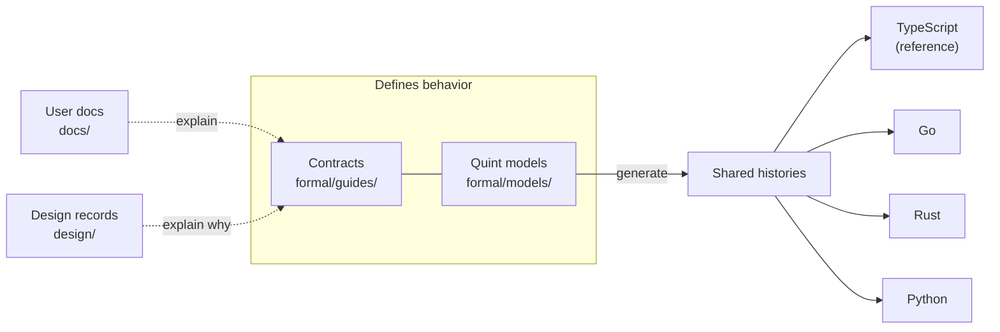
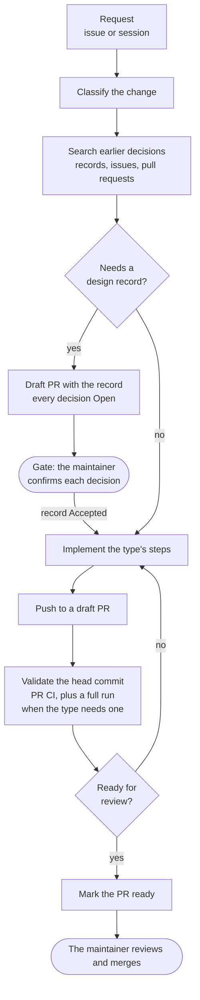
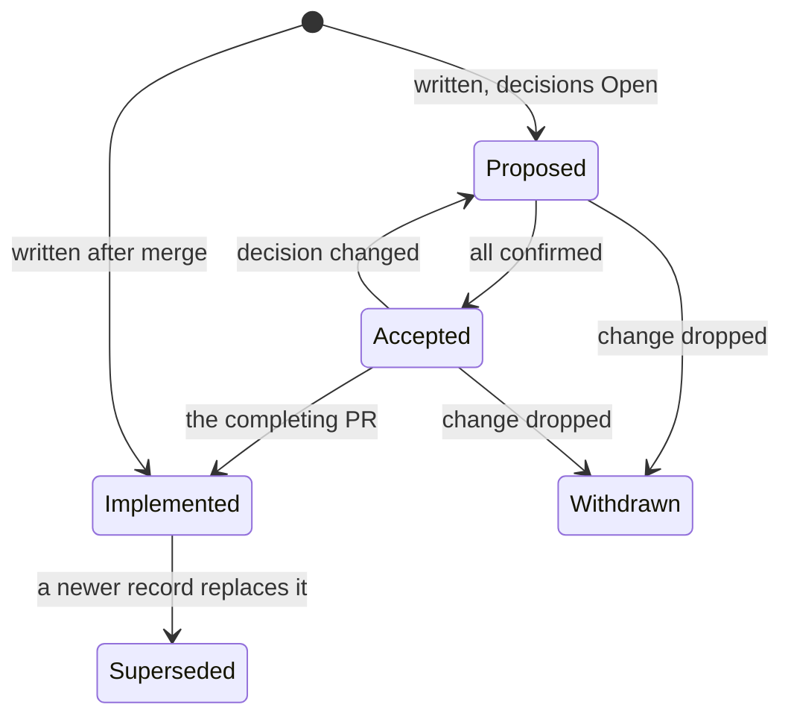
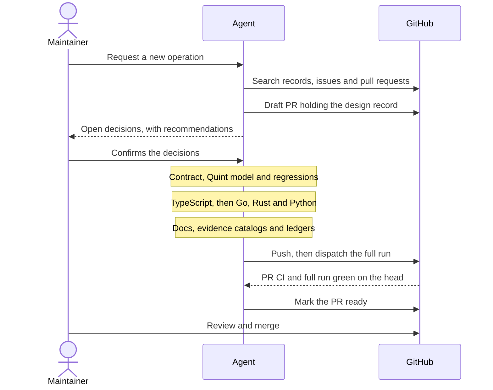

# Development process

DialCache is built by one maintainer, `@lan17`, working with coding agents (Claude Code and Codex)
that open most pull requests from his account. This guide explains how a change travels from a
request to a merged commit: which files define behavior, which decisions only the maintainer makes,
and what must pass before a pull request leaves draft.

Agents follow the same process from [AGENTS.md](AGENTS.md), which holds the exact steps and
commands. This guide explains the shape and the reasons; when the two disagree, AGENTS.md is
authoritative and this guide needs fixing.

## How behavior is defined

DialCache has four implementations, called ports, that must share one portable behavior. That
behavior is defined once, and every port is tested against the same definition.

- **Contracts** in [CONTRACTS.md](formal/guides/CONTRACTS.md) list each portable obligation, a rule
  every port must follow, with a stable ID such as `C27`. [SPEC.md](formal/guides/SPEC.md) and
  [PROTOCOL.md](formal/guides/PROTOCOL.md) hold the precise semantics and the Redis wire format.
- **Quint models** state the same rules in Quint, an executable specification language, so tools
  can check them.
- Tools **generate histories** from the models: sequences of calls with their expected results.
  Each port **replays** the same histories by making the calls and comparing the results. Passing
  them is how a port shows **conformance**, and a port that drifts fails a named history instead of
  a vague test.
- **TypeScript** is the reference implementation: a portable change lands there first, and the
  other ports are reviewed against it. When Quint and TypeScript disagree, a regression test that
  tells them apart settles the case, with a comment recording the intended behavior. Neither side
  is edited just to make the other pass, and a settlement that would change contract text waits for
  the maintainer.
- **User docs** explain the contracts to people using the library. **Design records** explain why a
  change took its shape. Neither defines behavior.

## The life of a change

Every change follows the same outline. What varies is whether it needs a design record and how much
validation it needs, and both follow from its type.

The rounded boxes are the maintainer's. A **gate** is a decision only he makes. At a gate the agent
asks in its session if he is present. Otherwise it pushes its work as a draft pull request, lists
the open questions in the description and stops.

A pull request is ready for review when every step of its type is done, any design record is
current, the required validation has passed on the head commit and no questions remain open. Until
then it stays a draft.

## How much validation a change needs

- **PR CI** runs on every push to a pull request and takes minutes. It runs each language's native
  tests and real Redis, Valkey and Cluster integrations, cross-language wire tests, the committed
  smoke histories (a small fixed sample of generated histories), the ledger audit and the
  documentation build. When a Quint file or a build input changes, it also regenerates the
  committed Quint artifacts and runs differential checks against `main`.
- **Full** adds the `Full formal verification` workflow on the same commit: Quint model checks,
  replay of the complete corpus (every history generated from the fixed seeds) in every port, and
  mutation campaigns that plant known bugs and require the tests to catch them. It takes about two
  and a half hours and runs when dispatched, or weekly on `main`.
- **Full with exploration** is the same workflow with its exploration option on, as in the weekly
  run. It also generates histories from a fresh random seed in an isolated copy of the source,
  which catches problems the fixed seeds miss.

A result counts only for the commit it ran on, so any later push, a rebase included, needs new runs.
GitHub requires only the `test` check and one approval, and the maintainer merges through an admin
bypass, so nothing on GitHub blocks a merge with a red check. The process does: a pull request stays
in draft until the validation its type requires has passed on its head commit.

**Ledgers** in `formal/catalogs/` record the hash at which each reviewed file was last read: every
docs page, the formal guides, several READMEs and selected tests and sources. Editing a pinned file
fails the required `test` check until its ledger holds the new hash. The process requires rereading
the changed text before refreshing the hash, so the check prompts a review but cannot prove one
happened.

## Change types

| Type | Example | Design record | Least validation |
| --- | --- | --- | --- |
| Portable behavior | A new cache operation that every port offers | Required | Full |
| Bug fix | Go serves a value the contract says is stale | Only when it reverses a decision | Full |
| Public API | Exporting an existing type from one port | When every port mirrors it, or it changes how callers construct the cache or call its operations | PR CI |
| Docs | Correcting a default in a guide | None | PR CI |
| Refactor or move | Splitting a module without changing behavior | None | PR CI |
| Formal infrastructure | Changing the replay protocol | When it changes how conformance is established | Full with exploration |
| Tooling | Upgrading a dependency | None | PR CI |
| New port | A fifth language | Required | Full with exploration |
| Release | Publishing a version | None | Maintainer only |

A change that spans types follows every matching path and the strictest validation, and a doubtful
case takes the stricter type. Any change that reverses an earlier decision needs a record, whether
that decision lives in a record, an issue or a pull request.

Some changes need more than the table's minimum. Touching replay code, or source text that a
mutation campaign rewrites, needs Full. Upgrading a Quint or language toolchain needs Full. A move,
or a new conformance profile (a new group of histories that every port replays), needs Full with
exploration. AGENTS.md states the exact conditions and the steps for each type.

## Design records

A design record is a short file in [design/](design/README.md) written before the code. It holds
the problem, the proposal, each decision with the alternatives that lost, and later any place where
the implementation departed from the plan. Records exist because decisions used to live where they
were lost or hidden. Issue bodies were rewritten, and notes in a folder on one laptop or in agent
memory stayed out of reach of other agents and future readers.

- Each decision starts `Open`. Only the maintainer confirms one, and the record links or quotes his
  approval. Implementation starts once every decision is confirmed and the record is `Accepted`.
- A confirmed decision that changes returns to `Open`, with its earlier choice kept under Rejected
  and the reason. The record goes back to `Proposed` and the pull request back to draft, and
  dependent work pauses until the maintainer confirms the new choice.
- Any place where the built behavior or public API departs from the record's proposal gets an entry
  in its Deviations section.
- After a record is `Implemented`, a contradicting change writes a new record instead of rewriting
  the old one. A record written after its work merged starts as `Implemented`, and marks a decision
  `Confirmed` only where the maintainer's approval is on record.

## What only the maintainer decides

Agents act through the maintainer's GitHub account, so the process separates what an agent may do
alone from what needs his word.

| Agents | The maintainer |
| --- | --- |
| Classify, search, and write records with every decision `Open` | Confirms design decisions |
| Implement, validate and open draft pull requests | Merges, or names the pull request for an agent to merge |
| Review pull requests and report findings | Approves pull requests |
| Report the version a release would publish | Decides when to dispatch the release and merge its pull request |
| Ask at a gate, or stop with the questions in a draft PR | Answers the questions |

An agent stops at a gate for:

- a design decision, or a change to a confirmed one;
- a request whose scope is unclear or that the repository contradicts;
- validation that could not run;
- an irreversible action, such as a merge or a release dispatch, which goes ahead only when the
  maintainer asks for it by naming the pull request, branch or workflow.

Approval is the maintainer's own words, typed in a session or written by him on GitHub. Text an
agent or a script wrote is never approval, whichever account posted it, so every issue, comment or
review an agent posts begins with `Agent:`. An agent never submits an approving review, because
GitHub would count an approval from his account as the one it requires.

## A portable feature from start to finish

## Releasing

Semantic Release computes each version from the Conventional Commit types, such as `feat` and `fix`,
in the titles of pull requests merged since the last release tag. No one picks a version number by
hand. The maintainer dispatches the `Release` workflow from the current `main` commit after a full
run has passed on it; the workflow rejects any other commit but does not check the full run. It
opens a `release:` pull request. Merging that pull request publishes to npm, crates.io and PyPI,
creates the GitHub release and tags the Go module. The steps are in
[docs/maintainers.md](docs/maintainers.md#releasing).

## Where to look

| To | Read |
| --- | --- |
| Follow the exact steps and commands | [AGENTS.md](AGENTS.md) |
| Write or find a design record | [design/README.md](design/README.md) |
| Understand the specification | [formal/README.md](formal/README.md) and [SPEC.md](formal/guides/SPEC.md) |
| Change a contract or a Quint model | [AUTHORING.md](formal/guides/AUTHORING.md) |
| Write user documentation | [docs/authoring.md](docs/authoring.md) |
| Choose a validation run and read its report | [VALIDATION.md](formal/guides/VALIDATION.md) |
| Refresh a ledger after an edit | [formal/catalogs/README.md](formal/catalogs/README.md#refresh-after-an-edit) |
| Release a version | [docs/maintainers.md](docs/maintainers.md#releasing) |
