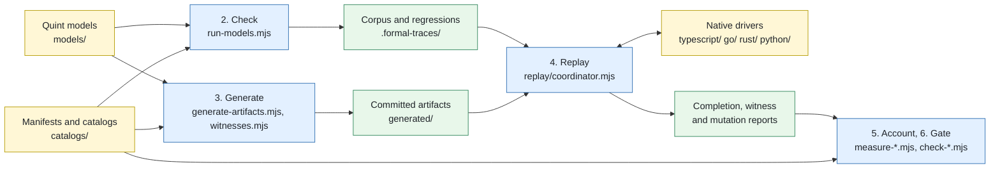
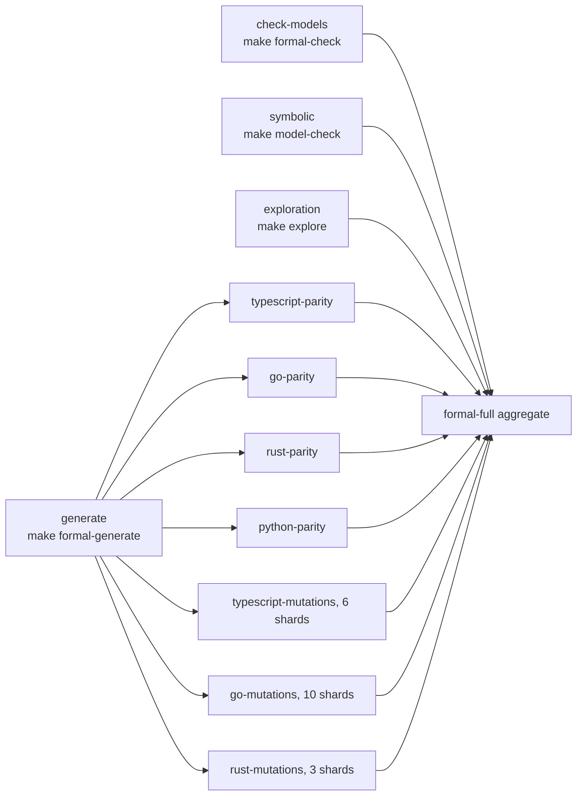

# Executable DialCache specification

DialCache's portable behavior is defined once, in Quint, and every language port
is held to the same generated histories. TypeScript is the executable reference
the models formalize; when the two disagree, the resolution is a distinguishing
[regression](./guides/GLOSSARY.md#corpus-history-regression-exported-run-and-public-only-run)
and a recorded decision, never an edit to whichever side is easier. Native
[drivers](./guides/GLOSSARY.md#driver) execute external commands against the
real libraries, and the expectations stay in the shared
[coordinator](./guides/GLOSSARY.md#coordinator), so no port can pass by
consulting its own predictions.

This page explains the setup from the models down to the CI lanes, then lists
where everything lives. [guides/README.md](./guides/README.md) indexes the prose
by kind and [GLOSSARY.md](./guides/GLOSSARY.md) defines the terms.

## Start with your task

| Task | Read first |
| --- | --- |
| See how the pieces fit together | [The setup, top to bottom](#the-setup-top-to-bottom), then [WALKTHROUGH.md](./guides/WALKTHROUGH.md) |
| Understand system behavior | [SPEC.md](./guides/SPEC.md), then the relevant model in [models/README.md](./models/README.md) |
| Follow one rule into every implementation | [WALKTHROUGH.md](./guides/WALKTHROUGH.md) |
| Change a behavior or extend coverage | [AUTHORING.md](./guides/AUTHORING.md) |
| Implement another language | [PORTING.md](./guides/PORTING.md) and [PROTOCOL.md](./guides/PROTOCOL.md) |
| Locate or reproduce a failing check | [TEST-MAP.md](./guides/TEST-MAP.md) and [Run it](#run-it) |
| See where one contract is stated, tested, challenged and mapped, or read one challenge or mutant in full | `node formal/tools/where.mjs C45` (or `C45.recheck-after-decode`, `B01.registration-and-policy-snapshot`, `recovery-inclusive-maximum`, `M01`) |
| Interpret validation results | [VALIDATION.md](./guides/VALIDATION.md) |
| Look up a term | [GLOSSARY.md](./guides/GLOSSARY.md) |

Start with readable Quint and a named regression. The JSON catalogs are indexes
and generated artifacts; a reader should not need to open them to learn a rule.
[CONTRACTS.md](./guides/CONTRACTS.md) gives stable obligation IDs and
[FEATURE-COVERAGE.md](./guides/FEATURE-COVERAGE.md) organizes their boundary cases.

## The setup, top to bottom

Six stages turn a rule into evidence. Each stage below names its directory, its
tool, what it produces and where to read more. The diagram summarizes the same
flow: yellow boxes are written by hand, blue boxes are the tools, green boxes
are what they produce, and the numbers are the stages below.



### 1. State the rule in Quint

[cache-rules.qnt](./models/cache-rules.qnt) holds the shared
[judgments](./guides/GLOSSARY.md#judgment-judged-once-and-applied-from-a-judgment)
every model imports: age, expiry, deadline and fence. The
[kernel library](./models/kernel/README.md) states the portable rules as pure
transitions over named shapes, one concern per module. A composed
[profile](./guides/GLOSSARY.md#profile-conformance-profile) assigns state only
through those transitions, exposes its external commands as public actions, and
records each step's command and choices in an explicit input, so replay never
infers a command from changed cache state. Sixteen of the seventeen conformance
profiles compose the kernel; the introductory core profile predates it. Beside
them sit the sum-typed verification models that are model-checked, the
connection models that hold a profile's history against
[cache-contract.qnt](./models/cache-contract.qnt), and the wire models that each
generate one vector file. Properties stay independent: an assertion never calls
the helper it challenges, and each named `Test` run is a public-action
regression that pins one boundary. Protocol classifiers use the same fence
judgment as the generated byte vectors and the behavioral remote reads.

Read more: [SPEC.md](./guides/SPEC.md) for the behavior,
[models/README.md](./models/README.md) for the file groups,
[kernel/README.md](./models/kernel/README.md) for the composition rules,
[AUTHORING.md](./guides/AUTHORING.md) to change a model.

### 2. Check the models

[execution.json](./catalogs/execution.json) schedules every model: its
invariants, bounds, trace paths and exported runs. `node
formal/tools/run-models.mjs check` typechecks each scheduled model, runs it with
the Rust evaluator and exports every public-only run of a profile model as a
regression; runs are discovered from the Quint source, never listed separately,
and a private state-patching run stays model-only unless it is rewritten as a
public action. `check-model-properties.mjs` runs the
[challenge](./guides/GLOSSARY.md#challenge-fault-mutant-and-reproducer) catalog
in the same manifest: for every scheduled model, at least one compiling
single-site fault that a named invariant must detect, with a deterministic
reproducer that fails only under the fault. `lint-profiles.mjs` ratchets the
composition and witness-isolation lint. Those three form the Quint evidence
[lane](./guides/GLOSSARY.md#lane), `make formal-check`. Two separate targets
read the models from another angle: `make model-check` verifies the finite
boundary rules in
[dialcache-rule-checks.qnt](./models/dialcache-rule-checks.qnt) symbolically
with Apalache, and the [differential](./guides/GLOSSARY.md#differential) replays
each composed profile's corpus against the merge base with `origin/main` in both
directions, so a change in observable behavior must be declared by bumping the
profile's `behaviorVersion`. A new profile has no previous text; it establishes
its behavior through independent properties, consequential witnesses and replay
in every port.

Read more: [VALIDATION.md](./guides/VALIDATION.md) for what each run proves,
[CHALLENGES.md](./generated/CHALLENGES.md) for the challenge index,
[AUTHORING.md](./guides/AUTHORING.md#mapping-every-challenge-to-native-mutants)
for writing one.

### 3. Generate the corpus and the committed artifacts

`make formal-generate` writes the sampled corpus and the exported regressions
under `.formal-traces/`, which is never committed, then evaluates the required
[witness](./guides/GLOSSARY.md#witness-label-and-classifier) labels from
[coverage-witnesses.json](./catalogs/coverage-witnesses.json) over the complete
corpus with `witnesses.mjs`. That language-neutral step is the sole producer of
the witness evidence every port lane reads, and it fails generation when a
gated label's sampled hits fall below
[witness-baseline.json](./catalogs/witness-baseline.json). The committed
artifacts under [generated/](./generated/README.md) are rebuilt by
`node formal/tools/generate-artifacts.mjs --write`: one
[smoke](./guides/GLOSSARY.md#smoke) trace per profile from the recipes in
[fixture-recipes.json](./catalogs/fixture-recipes.json), the lock that pins the
input hashes of every model, recipe and generator beside the output hashes, the
four wire vector files, and the witness fixtures under
`typescript/test/fixtures/`. `make fixtures-check` recomputes them all with
pinned Quint and fails on any difference. The read views
[PROFILES.md](./generated/PROFILES.md), [CHALLENGES.md](./generated/CHALLENGES.md)
and [MUTANTS.md](./generated/MUTANTS.md) are rendered from the replay
descriptors and the catalogs by `generate-catalog-docs.mjs --write` and need no
Quint.

Read more: [generated/README.md](./generated/README.md),
[catalogs/README.md](./catalogs/README.md),
[PORTING.md](./guides/PORTING.md#witness-evidence) for the witness evidence
fields.

### 4. Replay every history in every port

Each history is an [ITF](./guides/GLOSSARY.md#itf-informal-trace-format)
trace, the JSON trace format Quint writes. The
[coordinator](./replay/coordinator.mjs) runs it against a driver over the wire
protocol typed by
[protocol.schema.json](./replay/protocol.schema.json). It hands the driver the
fixture and each step's recorded external command, never the predicted
observation. The driver calls the real library, controls the external gates and
clocks, and reports actual results and effects. The coordinator validates each
observation, rejecting a malformed one as an infrastructure error before any
comparison, and asserts it against the model's prediction step by step. Profile
descriptors ([core.mjs](./replay/core.mjs), [effects.mjs](./replay/effects.mjs),
[features.mjs](./replay/features.mjs),
[local-clock.mjs](./replay/local-clock.mjs) and [profiles/](./replay/profiles/))
decode each profile's integer choices into driver commands;
[PROFILES.md](./generated/PROFILES.md) is their rendered view and
[profiles.json](./catalogs/profiles.json) is the profile registry. The drivers
are [behavior-driver.ts](../typescript/test/formal/behavior-driver.ts),
[behavior_driver_test.go](../go/behavior_driver_test.go),
[driver.rs](../rust/tests/formal/driver.rs) and
[driver.py](../python/tests/formal/driver.py). `make smoke` replays the
committed traces in all four ports; `make formal-ts`, `make formal-go`, `make
formal-rust` and `make formal-python` replay the complete generated corpus and
write a completion report.

Read more: [WALKTHROUGH.md](./guides/WALKTHROUGH.md) follows one history through
the ports, [PORTING.md](./guides/PORTING.md) is the driver contract with its
[observation contract](./guides/PORTING.md#observation-contract),
[replay/README.md](./replay/README.md) lists the modules,
[CONFORMANCE.md](./guides/CONFORMANCE.md) describes the core profile's trace
format and trust boundary.

### 5. Account for the evidence

`node formal/tools/conformance.mjs check` accepts a completion report only when
every scheduled case passed exactly once against the exact corpus and sources it
names. Witness coverage is required across the union of the named regressions
and the sampled corpus, so a corpus that stops reaching a corner is visible even
while the regressions keep the gate green. The mutation campaigns then challenge
the assertions themselves. [mutations.json](./catalogs/mutations.json) and
[rust-mutations.json](./catalogs/rust-mutations.json) catalog compiling semantic
faults in each port; `make mutations-ts`, `make mutations-go` and `make
mutations-rust` measure that the generated histories, the real-Redis
invalidation vectors and the shared witnesses detect every mapped mutant. Each
model challenge maps to the native mutant that injects the same wrong behavior,
and a mapped fault must violate its original property, fail the declared
expectation in a deterministic Quint run, and reach the same public assertion in
the completed TypeScript and Go recordings. Fixed corpora complement the
generated ones: [protocol-vectors.json](./catalogs/protocol-vectors.json),
[invalidation-vectors.json](./catalogs/invalidation-vectors.json) and
[behavioral-scenarios.json](./catalogs/behavioral-scenarios.json) carry
handwritten expectations, and their evidence mappings do not mechanically prove
that each fixed assertion agrees with Quint.
[semantic-cases.json](./catalogs/semantic-cases.json) and
[feature-coverage.json](./catalogs/feature-coverage.json) index every semantic
case and native feature family to its evidence; `where.mjs` answers from them.

Read more: [SEMANTIC-COVERAGE.md](./guides/SEMANTIC-COVERAGE.md) for the
evidence inventory and the mutation comparison,
[FEATURE-COVERAGE.md](./guides/FEATURE-COVERAGE.md),
[TEST-MAP.md](./guides/TEST-MAP.md), [CONTRACTS.md](./guides/CONTRACTS.md) for
the obligation IDs, [MUTANTS.md](./generated/MUTANTS.md) for the mutant index.

### 6. Gate a change

The ledgers in [catalogs/](./catalogs/README.md) make review state checkable.
[source-audit.json](./catalogs/source-audit.json) keys every reviewed guide and
ordinary test by its headings and contract dispositions, so a text edit is
followed by `node formal/tools/check-source-audit.mjs --refresh <path>`.
[go-parity.json](./catalogs/go-parity.json) pins the catalogs, sources and
dispositions the Go parity claim rests on and is re-pinned with
`node formal/tools/check-go-parity.mjs --refresh-inputs`. The lint, witness and
style baselines ratchet. `make audit` runs those checks together with the
semantic and feature coverage inventories, the generated-fixture and read-view
freshness checks and the Quint style caps. The pipelines below run it on every
change, and the full workflow runs everything above.

Read more: [TEST-AUDIT.md](./guides/TEST-AUDIT.md) for keeping the ledger
current, [GO-PARITY.md](./guides/GO-PARITY.md),
[tools/README.md](./tools/README.md) for every script behind a target.

## Pipelines

Three GitHub Actions workflows run the same Make targets as local work. The
diagram is the full workflow's job graph; the pull request lanes, which have no
dependencies between their jobs, are listed below it.



- **CI** ([ci.yaml](../.github/workflows/ci.yaml)) runs each language's native
  checks and real-server integration, the cross-language wire suite and the
  package floor. Its aggregate `test` job is the required check on `main`. A
  docs-only change clears it in a few minutes.
- **Formal smoke** ([formal.yaml](../.github/workflows/formal.yaml)) runs `make
  audit smoke`: the ledgers and inventories, then the committed traces in all
  four ports. When [fixture-scope.mjs](../.github/scripts/fixture-scope.mjs)
  detects a changed Quint input, the job also recomputes every committed
  artifact with pinned Quint, and on a pull request four `differential` shards
  replay the composed profiles against the merge base. Any edit to a Quint
  source counts, including a comment. The shards are migration evidence, not a
  completion claim, and take up to about half an hour.
- **Full formal verification**
  ([formal-full.yaml](../.github/workflows/formal-full.yaml)) runs weekly on
  `main` and on demand for any branch. `check-models` and `generate` run side by
  side; the four parity lanes and the three sharded mutation campaigns wait only
  for `generate`; the symbolic lane and, when scheduled or requested, the
  exploration lane run beside them. The `formal-full` aggregate requires every
  lane and keeps a summary artifact for 90 days. The scheduled run takes about
  two and a half hours.

The pull request lanes are fast checks. A behavior, model or replay change
requires the full workflow on its branch before merge, and the PR body records
which run. [VALIDATION.md](./guides/VALIDATION.md) explains how to choose a run
and how to read the reports.

## Where things are

| Directory | Holds | Index |
| --- | --- | --- |
| [guides/](./guides/) | The reviewed guides: contracts, how-tos and coverage reports | [guides/README.md](./guides/README.md) |
| [models/](./models/) | Every Quint model and shared helper, with the kernel library in `kernel/` and its fixtures in `fixtures/kernel/` | [models/README.md](./models/README.md) |
| [replay/](./replay/) | The shared replay coordinator, profile descriptors and witness classifiers every port executes | [replay/README.md](./replay/README.md) |
| [tools/](./tools/) | The Node scripts behind the `make` targets: checks, generators, measurements and runners | [tools/README.md](./tools/README.md) |
| [catalogs/](./catalogs/) | Hand-maintained manifests, evidence catalogs, ledgers, baselines and the fixed vector corpora | [catalogs/README.md](./catalogs/README.md) |
| [generated/](./generated/) | Smoke traces, the fixtures lock, generated vectors and the generated read views ([PROFILES.md](./generated/PROFILES.md), the [CHALLENGES.md](./generated/CHALLENGES.md) and [MUTANTS.md](./generated/MUTANTS.md) indexes); regenerated, never edited | [generated/README.md](./generated/README.md) |

## Run it

```sh
make help          # Targets and prerequisites.
make check         # Native checks, package, docs and inventories.
make audit         # Ledgers, inventories, generated views and the Quint style caps.
make smoke         # Committed Quint-derived histories in every port.
make formal        # Quint model checks, full corpus and every port's completion.
make differential  # Replay composed profiles' reference corpus through the working tree.
make model-check   # Separate finite symbolic checks; Java 21 and tar required.
make mutations     # Challenge assertions against the generated corpus.
make integration   # Real Redis/Valkey/Cluster in every port and interoperability.
make explore       # Fresh recorded seed in an isolated source snapshot.
make ci NODE22_BIN=/absolute/path/to/node22/bin/node
```

Pinned toolchain versions, the Docker and Java requirements and the environment
variables are in [VALIDATION.md](./guides/VALIDATION.md#prerequisites). After an
intentional model edit, run `node formal/tools/generate-artifacts.mjs --write`
before `make fixtures-check`. To replay one failing history, see
[Reproducing one history](./guides/VALIDATION.md#reproducing-one-history) and
the walkthrough's [run this example](./guides/WALKTHROUGH.md#run-this-example).

Query the inventories instead of copying changing totals between documents:

```sh
node formal/tools/execution.mjs
node formal/tools/check-semantic-coverage.mjs
node formal/tools/check-feature-coverage.mjs
node formal/tools/run-models.mjs check --dry-run
```

## Reference

Every part of the system, one line per group, for reading further.

- **Contract guides:** [SPEC.md](./guides/SPEC.md), [CONTRACTS.md](./guides/CONTRACTS.md), [PROTOCOL.md](./guides/PROTOCOL.md), [CONFORMANCE.md](./guides/CONFORMANCE.md), [BEHAVIOR.md](./guides/BEHAVIOR.md).
- **Tooling guides:** [WALKTHROUGH.md](./guides/WALKTHROUGH.md), [AUTHORING.md](./guides/AUTHORING.md), [PORTING.md](./guides/PORTING.md), [VALIDATION.md](./guides/VALIDATION.md), [GO-PARITY.md](./guides/GO-PARITY.md), [GLOSSARY.md](./guides/GLOSSARY.md).
- **Coverage guides:** [SEMANTIC-COVERAGE.md](./guides/SEMANTIC-COVERAGE.md), [FEATURE-COVERAGE.md](./guides/FEATURE-COVERAGE.md), [TEST-MAP.md](./guides/TEST-MAP.md), [TEST-AUDIT.md](./guides/TEST-AUDIT.md); measurements at the revisions they were made in [HISTORY.md](./guides/HISTORY.md).
- **Generated views:** [PROFILES.md](./generated/PROFILES.md), [CHALLENGES.md](./generated/CHALLENGES.md), [MUTANTS.md](./generated/MUTANTS.md).
- **Shared Quint helpers:** [cache-rules.qnt](./models/cache-rules.qnt), [cache-contract.qnt](./models/cache-contract.qnt), [cohort-boundaries.qnt](./models/cohort-boundaries.qnt), [conformance-observations.qnt](./models/conformance-observations.qnt), [wire-text.qnt](./models/wire-text.qnt); the [kernel library](./models/kernel/README.md) and its [fixtures](./models/fixtures/kernel/).
- **Verification models:** [core](./models/dialcache-core.qnt), [runtime-policy](./models/dialcache-runtime-policy.qnt), [tracked-invalidation](./models/dialcache-tracked-invalidation.qnt), [stale-recovery](./models/dialcache-stale-recovery.qnt), [redis-protocol](./models/dialcache-redis-protocol.qnt), [rule-checks](./models/dialcache-rule-checks.qnt).
- **Conformance profiles:** [core](./models/dialcache-conformance.qnt), [effects](./models/dialcache-effects-conformance.qnt), [scope](./models/dialcache-scope-conformance.qnt), [recovery](./models/dialcache-recovery-conformance.qnt), [policy](./models/dialcache-policy-conformance.qnt), [shadow](./models/dialcache-shadow-conformance.qnt), [admission](./models/dialcache-admission-conformance.qnt), [layers](./models/dialcache-layers-conformance.qnt), [independent](./models/dialcache-independent-conformance.qnt), [recovery-read](./models/dialcache-recovery-read-conformance.qnt), [local-failure](./models/dialcache-local-failure-conformance.qnt), [runtime-boundaries](./models/dialcache-runtime-boundaries-conformance.qnt), [shadow-layers](./models/dialcache-shadow-layers-conformance.qnt), [local-clock](./models/dialcache-local-clock-conformance.qnt), [source-budgets](./models/dialcache-source-budgets-conformance.qnt), [dark-layers](./models/dialcache-dark-layers-conformance.qnt), [shadow-read-deadlines](./models/dialcache-shadow-read-deadlines-conformance.qnt); one line each in [models/README.md](./models/README.md), decodings in [PROFILES.md](./generated/PROFILES.md).
- **Connection and wire models:** [source](./models/dialcache-source-connection.qnt), [recovery](./models/dialcache-recovery-connection.qnt), [recovery-read](./models/dialcache-recovery-read-connection.qnt), [independent](./models/dialcache-independent-connection.qnt), [shadow-layers](./models/dialcache-shadow-layers-connection.qnt); [key-protocol](./models/dialcache-key-protocol.qnt), [frame-vectors](./models/dialcache-frame-vectors.qnt), [envelope-vectors](./models/dialcache-envelope-vectors.qnt), [invalidation-transition](./models/dialcache-invalidation-transition.qnt).
- **Manifests and catalogs:** [execution.json](./catalogs/execution.json), [profiles.json](./catalogs/profiles.json), [semantic-cases.json](./catalogs/semantic-cases.json), [coverage-witnesses.json](./catalogs/coverage-witnesses.json), [feature-coverage.json](./catalogs/feature-coverage.json), [mutations.json](./catalogs/mutations.json), [rust-mutations.json](./catalogs/rust-mutations.json), [fixture-recipes.json](./catalogs/fixture-recipes.json), [behavioral-scenarios.json](./catalogs/behavioral-scenarios.json); the ledgers and baselines [source-audit.json](./catalogs/source-audit.json), [go-parity.json](./catalogs/go-parity.json), [profile-lint-baseline.json](./catalogs/profile-lint-baseline.json), [witness-baseline.json](./catalogs/witness-baseline.json), [style-allowlist.json](./catalogs/style-allowlist.json); the fixed corpora [protocol-vectors.json](./catalogs/protocol-vectors.json), [invalidation-vectors.json](./catalogs/invalidation-vectors.json).
- **Replay:** [coordinator.mjs](./replay/coordinator.mjs), [bindings.mjs](./replay/bindings.mjs), [settlement.mjs](./replay/settlement.mjs), [protocol.schema.json](./replay/protocol.schema.json), the descriptors in [profiles/](./replay/profiles/) and the classifiers in [witnesses/](./replay/witnesses/).
- **Tools:** [validation.mjs](./tools/validation.mjs) dispatches every target; [execution.mjs](./tools/execution.mjs), [where.mjs](./tools/where.mjs), [run-models.mjs](./tools/run-models.mjs), [generate-artifacts.mjs](./tools/generate-artifacts.mjs), [witnesses.mjs](./tools/witnesses.mjs), [differential.mjs](./tools/differential.mjs), [explore.mjs](./tools/explore.mjs), [check-source-audit.mjs](./tools/check-source-audit.mjs), [check-go-parity.mjs](./tools/check-go-parity.mjs), [check-style.mjs](./tools/check-style.mjs); the rest in [tools/README.md](./tools/README.md).
- **Scope and claims:** the specification and tests use declared finite domains, and the profiles deliberately bound callers, keys, contexts, capacities, payloads and time without claiming that every product of those domains is explored. Environmental assumptions, allowed races and the limits of conformance claims are centralized in [SPEC.md](./guides/SPEC.md#assumptions-evidence-and-claims); the wire and binding obligations are in [PROTOCOL.md](./guides/PROTOCOL.md) and [GO-PARITY.md](./guides/GO-PARITY.md).
